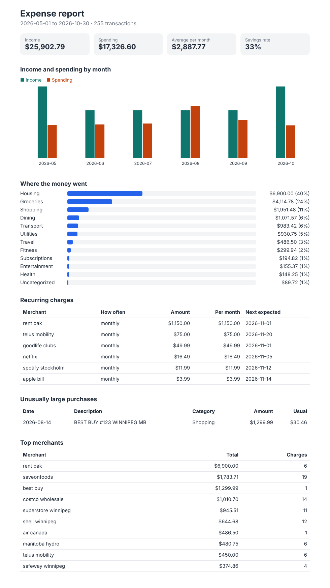

# Expense Analyzer

A command-line tool written in Python. It imports bank statement CSV files, sorts every transaction into a category, and then answers questions: where does my money go, which subscriptions am I paying for, and which purchase looked unusual?

Everything runs on your own computer. Your bank data is stored in a local SQLite file and is never uploaded anywhere. The tool uses only the Python standard library, so there is nothing to install except Python itself.



## What it does

- **Reads messy bank CSVs.** It finds the header row (even with lines of text above it), recognises common column names, handles separate Debit/Credit columns or one signed Amount column, and detects the date format (`2026-05-01`, `05/01/2026`, `01/05/2026`, `May 1, 2026`). Amounts like `$1,234.56`, `(45.10)`, `45.10-` and `1.234,56` all work.
- **Never imports the same row twice.** Every transaction gets a fingerprint, so you can import overlapping statements safely.
- **Categorizes with rules you can teach.** Built-in keyword rules cover the common cases. Add your own (`rules add Groceries "corner market"`) and re-apply them.
- **Finds recurring charges.** Detects subscriptions and bills that repeat weekly, every two weeks, monthly or yearly, and tells you what they cost per month.
- **Flags unusual purchases.** A purchase is judged against the same merchant's history (or its category), using a method that is not fooled by the outliers it is looking for.
- **Reports.** Terminal tables, a full HTML report with charts (one self-contained file), and CSV export.

## Quick start

You need Python 3.10 or newer (download it from python.org and tick "Add Python to PATH" in the installer).

```bash
# in the project folder
python -m venv .venv
.venv\Scripts\activate            # Mac/Linux: source .venv/bin/activate
pip install -e ".[dev]"

expense-analyzer import sample/statement_debit_credit.csv
expense-analyzer summary
expense-analyzer recurring
expense-analyzer anomalies
expense-analyzer report --open
```

The `sample/` folder contains fake statements so you can try everything straight away. For your own data, export a CSV from your bank's website and import that instead. No setup is needed: the tool works out the columns and date format by itself.

If the command `expense-analyzer` is not found, use `python -m expense_analyzer` instead.

## Commands

| Command | What it does |
|---|---|
| `import FILE` | Read a bank CSV and save it. Options: `--dry-run`, `--date-format`, `--expenses-positive`, `--date-col` and friends |
| `summary [--month 2026-05]` | Income, spending and net per month, plus spending by category |
| `list [--category X] [--month M] [--limit N]` | Show saved transactions |
| `merchants [-n 10]` | Where you spend the most |
| `recurring` | Subscriptions and repeating bills, with the monthly and yearly cost |
| `anomalies` | Unusually large purchases |
| `report [-o report.html] [--open]` | Full HTML report |
| `export FILE` | Save everything as CSV |
| `rules list` / `rules add CATEGORY KEYWORD` | See or add your own categorization rules |
| `recategorize` | Apply new rules to saved transactions |
| `set-category ID CATEGORY` | Fix one transaction by hand (never overwritten) |
| `reset --yes` | Delete all imported transactions |

Data lives in `~/.expense_analyzer/` (change it with `--data-dir` or the `EXPENSE_ANALYZER_HOME` environment variable).

## How it is built

```
src/expense_analyzer/
  parser.py       CSV -> Transaction objects (headers, dates, amounts, row errors)
  categorizer.py  keyword and regex rules, merchant-name cleanup
  storage.py      SQLite: save, dedupe, filter, manual categories
  analysis.py     pure functions: monthly totals, categories, recurring, anomalies
  report.py       terminal tables and the HTML report (inline SVG, no libraries)
  cli.py          argparse commands that connect the pieces
```

Design decisions worth knowing:

- **Money is `Decimal`, stored as whole cents.** Floats cannot represent cents exactly (`0.1 + 0.2` is not `0.3`), which is unacceptable for money.
- **The analysis code never touches the database or the screen.** It takes lists in and returns results, which is why it is easy to test thoroughly.
- **Deduplication uses a content fingerprint** (date, description, amount, and a counter for identical rows on the same day), so two real $4.50 coffees on one day are kept, but re-importing a file adds nothing.
- **Anomaly detection uses the median and the median absolute deviation (MAD)** instead of the average and standard deviation, because a single $1,300 purchase would inflate the standard deviation and hide itself.
- **Rule conflicts are decided predictably:** your rules beat the defaults, then the longest matching keyword wins, so `uber eats` (Dining) beats `uber` (Transport).
- **"Transfers" (credit card payments, moving money between accounts) are excluded** from income and spending, otherwise they would be counted twice.
- **Exports are protected against spreadsheet formula injection**, and the HTML report escapes all text from the bank file.

## Tests

```bash
pytest                      # 112 tests
python -m unittest discover -s tests    # also works, with PYTHONPATH=src:tests
```

The tests cover amount and date parsing in many formats, categorization rules and conflicts, the database layer, the calculations (including edge cases like refunds, empty months and variable bills), report escaping, and every command-line command end to end using the sample files.

## Limitations

- It categorizes by keywords, so unusual merchants land in "Uncategorized" until you teach the tool. That is by design: it is predictable and explainable.
- Merchant grouping is a heuristic (it keeps the first two meaningful words), so two different shops with similar names can occasionally be grouped together.
- Only one currency, shown with a `$` sign.
- Statements must be CSV. PDF statements are not supported.

## Ideas for next steps

- Budgets per category with warnings.
- Import OFX/QFX files, which many banks offer.
- A small web interface on top of the same `analysis` module.
